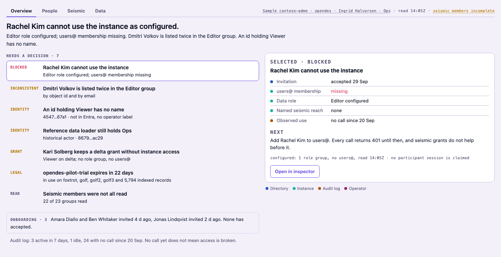

# @keelson/rib-adme

A [keelson](https://github.com/danielscholl/keelson) rib for administering an
[Azure Data Manager for Energy](https://learn.microsoft.com/azure/energy-data-services/)
(ADME) instance: who has access, what data is in it, and who can reach each
seismic subproject.

**Status: console built.** One console reads a live instance; seismic grant
and revoke are the only writes, each through a previewed plan. Applying plans
to a real instance is the part still being proven.

## What it covers

One ADME tab, led by a console with four views. Every view resolves ids through
one identity directory: the names Microsoft Graph returns plus the operator's
own annotations, so an id the directory cannot name shows the operator's label
everywhere it appears.

- **Overview.** What needs a decision, ranked: someone blocked, an entry listed
  twice, an id holding access that nothing names, a seismic grant without
  instance access, a legal tag in use that needs care, or a read that failed,
  is incomplete or is past its limit. Pending invitations and people with no
  call yet sit below as onboarding and adoption; they never count as decisions.
- **People.** The directory: search by name, address, label, organization or
  id, and a profile that answers "can this person get started?" before it
  shows group mechanics.
- **Seismic.** A person by subproject matrix of configured access: explicit
  Admin or Viewer, default reach, a grant that cannot be used, a group that was
  not read. Each cell shows its path from person to group to subproject.
- **Data.** Record families with their scope, and a stewardship queue of legal
  tags in use. The partition map sits below the console as Explore the
  partition, and record search opens in the drawer as Find records.

Selecting anything in the console fills its pane; Open in inspector moves it to
the side drawer, where every verb lives.

The rib works from the operator's Azure CLI sign-in and stores no secret. Every
change is a dry-run plan first; nothing is written until the plan is applied.

The rib is built around one instance and the way it is run: cohorts of people
from partner organizations, a roster group, and seismic subprojects granted per
person. Connecting is a one-time setup that records that instance's profile.
Another ADME instance run differently may not fit, and multiple instances are
not planned.

## Install

```sh
keelson rib add github:danielscholl/keelson-rib-adme
keelson restart
```

Then sign in to the tenant that holds the instance and open the ADME tab:

```sh
az login --tenant <tenant id>
```

The first-run journey lists the ADME instances that sign-in can see in Azure,
across every subscription. Connect on one saves its host, partition, tenant
id and ADME app id as the profile; none of them is secret. Without an Azure
role on the instance, enter them by hand. Test connection makes about eight
read-only calls, reads the entitlements domain from the instance and records
what this sign-in can do. A missing capability disables the feature that needs it.

## How it reaches the instance

The rib runs inside the Keelson server. Before each batch of calls it asks
`az account get-access-token` for a token for the ADME app id, Microsoft Graph
and Azure Resource Manager, scoped to the profile's tenant, and calls the ADME
services, Graph and the instance's Resource Health directly. When the sign-in
lapses, the tab says "sign-in needed", keeps showing the last sweep, and
pauses changes until `az login` and Re-test.

The last sweep is cached in the rib's data directory (`~/.keelson/rib-adme`).
A sweep runs on Refresh now, after Re-test, on the first action after an idle
spell, and on a timer only within 15 minutes of the last action. Seismic
membership is read at most every 30 minutes. Each read carries its age and
completeness, and a read past its limit (24 hours for seismic members and the
audit log, 2 hours for the rest) becomes a decision until a fresh one lands.

## What to know before using it

- Names, email addresses and object ids appear as plain text in board frames
  and in the rib's data directory. That suits a single operator on a local
  workbench; don't run it on a shared host.
- Annotations (labels, organizations, former addresses, notes) are kept in
  `directory.<host>.<partition>.json` in the data directory. They name and
  describe; they never override a directory name and never grant anything.
- The drawer selection is held by the rib, not per browser window: two windows
  share one drawer target.

## Develop

```sh
bun install
bun test && bun run typecheck && bun run check
keelson rib add "$PWD" && keelson restart
```

### Sample instance

Start the server with `KEELSON_ADME_SAMPLE=1` and the rib serves the made-up
`contoso-adme` instance from [design/spec.md](design/spec.md) instead of a live
one: 31 people from 12 organizations, 4 applications, two labelled loaders and
an id nobody has named, 13 seismic subprojects with one group that refuses its
member list, 15 legal tags, 1,284,512 records and an audit log, so every
decision class has a case. Every read goes through the real composers. Nothing
calls `az` or the network, every write is refused, and the console says
"Sample". `bun dev/brief.ts` prints its brief and `bun dev/console.ts out.html`
writes its console to a file. Its clock starts at the spec's 2026-10-02
14:05Z, and it keeps its own store in `rib-adme/sample`, so a real profile is
never touched. Use it for demos, recordings and screenshots.

## Design

- [design/console.md](design/console.md): the console, its identity directory,
  status model and decision classes.
- [design/README.md](design/README.md): the original design document.
- [design/adme-access-desk.html](design/adme-access-desk.html): the interactive
  mockup. Download it and open it in a browser. It draws the three tabs and the
  inspectors with the markup and styles Keelson's board renderer uses, on
  sample data.
- [design/spec.md](design/spec.md): the screen-by-screen specification the
  mockup is built from.



## License

Apache-2.0. See [LICENSE](LICENSE) and [NOTICE](NOTICE).
