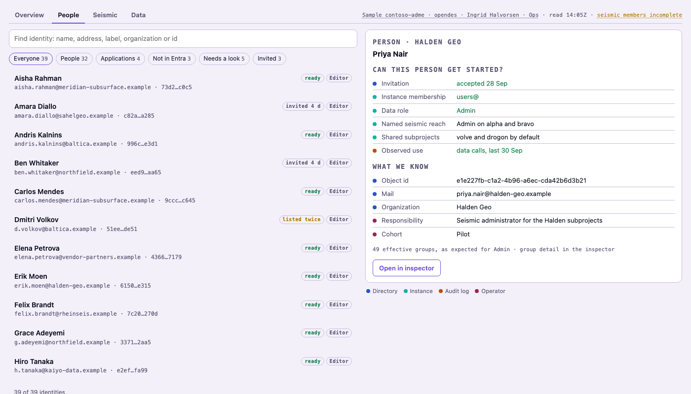
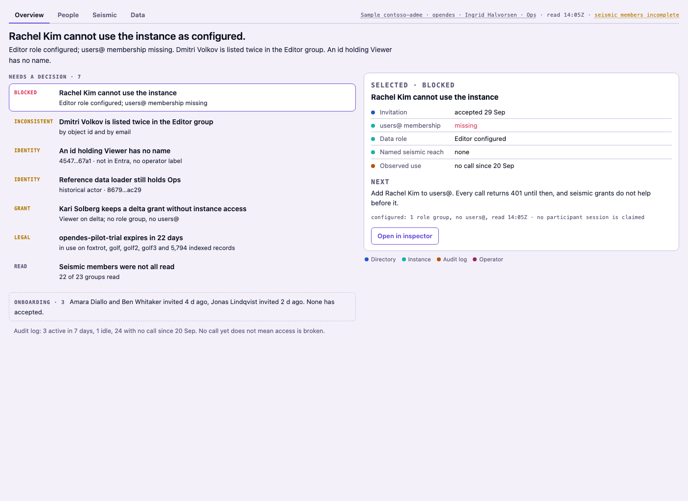
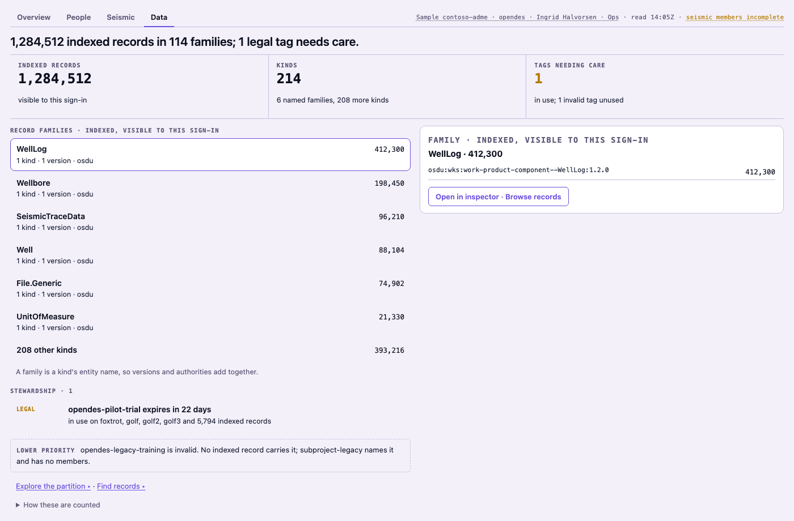

# ADME console

The ADME tab is one console over a shared identity directory, so an operator can
see who an identity is, what it can reach and what needs a decision without
matching ids across sections and a hand-kept handbook. Every name, count and id
here is the sample instance (`KEELSON_ADME_SAMPLE=1`).

**Before.** The tab had three sections, Access, Data and Seismic, each a stack of
board regions. Access opened on one count that added people who could not use
the instance to people who had not accepted, people who had made no call yet,
and principals Entra could not resolve, so it read as unfinished administration
on a day nobody was blocked. Each section resolved ids on its own, so a
principal the operator knew as a historical loader was "unknown" in one place
and a bare object id in another. Seismic membership was read once and kept, so
a stale partial read looked like a fresh one.

**Now.** One HTML console with four views (Overview, People, Seismic, Data) sits
on three layers: an identity directory every view resolves through, a status
model that keeps onboarding, configured access, observed use and read
completeness apart, and a brief that writes every word the console, the
inspector and `adme_brief` show. Clicks in the console only select; evidence and
every verb live in the side inspector. Changes still go through preview,
revalidate, apply and verify.

**Not in it.** No new write path: seismic grant and revoke stay the only writes.
Configured access is not proof that a call succeeds, and the console says which
one it shows. Annotations never override a directory name and never grant
anything. The generated handbook editions and the handbook import are held for
a later pass.

## Layers

| Layer | Code | What it does |
|---|---|---|
| Identity directory | `src/directory/` | Resolves any id the rib shows (role members, seismic members, record creators, plan rows) to one identity: key, kind, name and where the name came from, addresses past and present, organization, annotation. |
| Status | `src/status/` | Places an identity on four axes and gives every read three signals. Pure. |
| Brief | `src/brief/` | Turns the directory, the status model and the cached reads into decisions, onboarding, adoption, people rows, the seismic matrix and the data view. Pure, except `inputs.ts`, which gathers from the runtime. |
| Console | `src/boards/console*.ts` | Lays the brief out as sandboxed HTML with selection and search. No words of its own. |
| Inspector | `src/boards/inspect.ts`, `src/modules/console.ts` | One drawer for items, reads, tags, cells, subprojects, families and identities outside the people list; people open the person inspector. |

## Identity directory

An identity's key is the tenant, the identifier type (object id, app id, email
or group) and the value: `object:<tenant>:<object id>`. Email stays searchable,
but it is never the key for an account that has an object id, because a guest's
address can change.

Facts come from Graph and the instance on every sweep. Annotations come from the
operator and live in `directory.<host>.<partition>.json` in the data directory,
validated with zod; a file that does not parse is never overwritten.

```json
{
  "entries": {
    "object:1f2e8c47-…-9a00:<loader id>": {
      "label": "Reference data loader",
      "kind": "historical-actor",
      "note": "Loaded the OSDU reference values in March 2025",
      "source": { "from": "handbook", "at": "2026-10-01" }
    },
    "object:1f2e8c47-…-9a00:<Marcus Oyelaran's id>": {
      "organization": "Northfield Energy",
      "formerAddresses": ["marcus@oldco.example"],
      "source": { "from": "operator", "at": "2026-10-01" }
    }
  }
}
```

A directory name always leads. A label names only an id the directory cannot,
and it follows the id everywhere: Overview, People, matrix rows, record creator
and modifier, plan rows. Add note and Label this id are board forms in the
inspector; they write only to the annotations file.

## Status

| Axis | Source | Values |
|---|---|---|
| Onboarding | Directory | invited (with age), accepted, member account |
| Configured access | Instance | ready, blocked (no users@, deleted in Entra), inconsistent (listed twice, users@ with no role), none, not measured |
| Observed use | Audit log | active in 7 days, idle, no call yet, not measured |
| Identity | Directory, operator | resolved, labelled, unresolved |

Every read area (access, audit log, seismic members, legal tags, record kinds,
tag and group counts) carries availability from the health probes, completeness
(for seismic, groups read out of groups listed) and freshness against its limit:
24 hours for seismic members and the audit log, 2 hours for the rest. The stamp
shows the read time and adds an amber note only when a read failed, is
incomplete, is past its limit, or a service is not answering.

## Overview


| Class | Raised when | Clears when |
|---|---|---|
| BLOCKED | A role holder has no users@, or the id is deleted in Entra | A sweep reads users@, or the role is gone |
| INCONSISTENT | Listed twice in one group (object id and email), or users@ with no role | A sweep reads one entry |
| IDENTITY | An id with a role or grant that neither the directory nor a label names; or a labelled historical actor that still holds a role | Labelled (or labelled as anything but a historical actor), or the access is gone |
| GRANT | An explicit seismic grant held by someone with no users@ and no role | Grant revoked, or instance access restored |
| LEGAL | A tag used by records or by a subproject with members is invalid or expires within 30 days | Tag extended, or no longer used |
| READ | A read failed, is incomplete, or is past its limit | A complete read inside the limit |

Classes rank in that order, oldest first within a class. LEGAL tags carried only
by records fold into one item per state ("14 invalid legal tags still hold 31
indexed records"), listing the largest; a tag a seismic subproject with members
relies on stays its own item. Data's stewardship queue and the inspector keep one
item per tag. The headline names the
top class; with nothing to decide it says "Nobody is blocked." and the summary
names the oldest pending invitation. Never a decision: a pending invitation,
accepted with no call, idle, an invalid tag nothing uses, a labelled historical
actor with no role, a subproject with no members.

## People



Search runs inside the frame over names, addresses past and present, labels,
organizations and ids, so it costs no call. Facets: people, applications, ids
not in Entra, needs a look, invited. The profile answers "can this person get
started?" (invitation, users@, role, named seismic reach, shared subprojects,
observed use) before what we know. Past 80 identities a row opens the inspector
instead of a pane.

The person inspector leads with the same ladder and operator notes, lists
seismic groups as named reach rather than extra groups, keeps the raw effective
group list behind a disclosure, carries the access note a partner needs (listing
subprojects is admin only), and has Add note.

## Seismic



Rows are identities with an explicit grant; applications show with a toggle.
Columns are own-ACL subprojects; default-ACL ones fold into Shared, and
subprojects with no members or one admin fold into a line under the matrix.

| Cell | Meaning |
|---|---|
| A, V | Explicit Admin or Viewer, configured |
| D | Reach through the default data groups with a data role |
| V!, A! | Explicit grant held without users@ or a role |
| D* | Default reach that does not work yet: invited, or missing users@ |
| ? | A group of this subproject was not read; hatched, never blank |
| · | Both groups read, identity absent |

Selecting a cell shows the path from person to group to subproject and every
subproject that group backs. The cell inspector holds Preview grant and Preview
revoke; a grant to someone with no instance access is disabled with the reason.
A column header opens the subproject with its members and the relationship
flow. Cells are bare table cells and each pane is one template per subproject
and mark that the frame fills with the row's name, so a cell costs a few bytes. The plan sheet for a seismic change leads with who, then current against
proposed over every subproject the touched groups back, then each group's reach.

## Data



Record families (a kind's entity name, so versions and authorities add
together) with their counts, indexed and visible to this sign-in. The
stewardship queue holds LEGAL items; an invalid tag nothing uses sits below as
lower priority. The partition map sits below the console as Explore the
partition; Find records and a family's Browse records open record search in the
drawer. The record inspector names creator and modifier through the directory,
and offers Label this id for one nothing names.

## Frame size

The frame must stay under 256 KB. When the console would not fit, it gives up
in order: profile panes past 20 people, then every profile pane (rows open the
inspector), then the matrix, which becomes a list of subprojects with their
admin and viewer counts. `test/console-size.test.ts` holds both ends: a hundred
grant holders on every subproject keep the matrix, two hundred get the list.

## Inspector ids

| Id | Opened from | Holds |
|---|---|---|
| `item:<class>:<key>` | Overview and Data rows | Evidence by source, next step, the class's verb |
| `who:<id>` | People rows, matrix rows | Person inspector for people and applications; an identity board with Label this id for ids outside the people list |
| `cell:<id>:<subproject>` | Matrix cells | Path, groups, every subproject they back, grant and revoke previews |
| `sub:<name>` | Matrix column headers | Identifiers, members by name, the flow, grant forms |
| `read:<area>` | Stamp notes, READ items | Availability, completeness, freshness, Re-read |
| `tag:<name>` | LEGAL items | Tag profile and where it is used |
| `fam:<entity>` | Data families | Kinds and Browse records |
| `connection`, `cohorts`, `find` | Stamp and links | Connection details, cohorts, Find records |

The frame may send only `inspect`; `onAction` refuses any other action from a
`canvas-html` origin.
